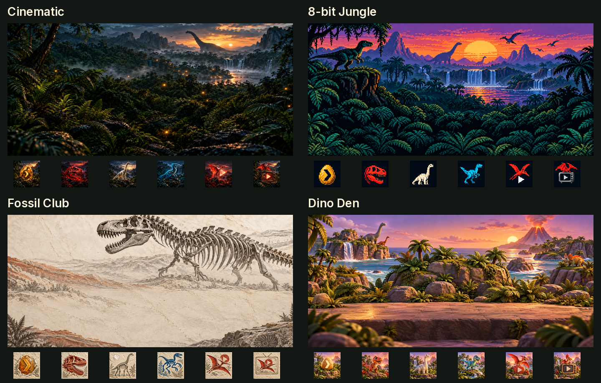

# Samsung TV Launcher

A native Samsung Tizen home screen with switchable themes, six streaming-app shortcuts, HDMI switching, and a way back to Samsung Home. Four dinosaur theme packs and the cyberpunk Neon District are bundled. Built for an owner-controlled **S90D on Tizen 9**, using .NET/NUI and Samsung's existing picture, audio, app, and HDMI stack.



*Generated theme-art previews, not photographs of a TV. The running launcher uses independent native controls and live focus states.*

[Neon District artwork and generation notes](docs/cyberpunk-theme.md) cover the additional cyberpunk pack.

## Features

- **Cinematic**, **8-bit Jungle**, **Fossil Club**, **Dino Den**, and **Neon District**, with title-free wallpapers and six custom app illustrations. New data-only packs are discovered at runtime.
- All five packs have scene-specific motion: flying creatures/vehicles, mist/clouds/smoke or museum light, plus selected-character blinks or material-light pulses, with a saved **Off / Subtle / Full** control on Home. Effects pause when the launcher leaves the foreground.
- A remote-friendly theme picker. The selected theme is saved in the launcher's own app data and survives a launcher restart.
- Shortcuts for **Plex, Netflix, Apple TV, Prime Video, YouTube, and YouTube TV**. These launch installed Tizen apps; they do not replace the apps or provide subscriptions.
- A [local photo screen](docs/local-photos.md) with album browsing, slideshow controls and metadata-free private exports; no always-on computer is required after installation.
- A [phone companion](docs/companion.md): scan a QR code on the TV to switch themes, reorder or hide tiles, rename the HDMI shortcut and upload photos from a phone on the same Wi-Fi.
- [Reactive scenes](docs/reactive-scenes.md): Home follows the time of day, the season and the local weather, with a one-minute preview from the phone.
- HDMI switching, an input-picker shortcut, quick settings, and access to Samsung's full settings.
- Optional Home/startup routing to the custom launcher, plus a **Samsung Home** shortcut inside it.
- Snapshot-first deployment and guarded native routing/rollback helpers. No firmware flashing or permanent root daemon.

## Tested scope

| Item | Evidence |
| --- | --- |
| TV | `QN77S90DDFXZA`, 77-inch S90D |
| Firmware | `T-PTMDAKUC-0090-2130.0` |
| Runtime | Tizen 9.0, Linux 5.4.249 ARMv7, .NET 6.0.9 |
| Access | Temporary authenticated UID/EUID 0; staging cleanup and unchanged password/SDB-key hashes checked |
| Launcher | Owner reviewed the original themes; four dinosaur packs and Neon District switched on the TV with 12/12 cached image views ready per pack |
| Motion | Off/Subtle/Full state checks, picker cleanup, pause/return through Samsung Home and preference persistence checked; visual review and GPU performance remain separate |
| Theme persistence | Saved selection survived a launcher process restart |
| Playback | Owner confirmed Plex with sound, and reported Netflix, Apple TV, Prime Video, and YouTube working |
| HDMI | Owner confirmed switching to the connected HDMI device |
| YouTube TV | Installed app ID verified and shortcut included; playback not separately verified |
| Home/startup routing | Native readback and unchanged Buxton privileges verified; owner confirmed Home/Samsung Home round trip and automatic launch after a full TV restart |
| Privacy cleanup | **Not applied or audited on this S90D** |

Other sizes, regions, models, and firmware builds are unverified. A successful root check does not establish launcher, Home routing, or cleanup compatibility. This is a model-specific project, not a universal Samsung installer, a replacement OS, or an Android launcher.

## Get started

Read [the S90D setup guide](docs/10-s90d-setup.md), [Home routing](docs/11-home-routing.md), and [recovery](docs/09-recovery.md) before changing a TV.

You need Linux/macOS/Windows host tooling appropriate to your environment, Python 3.12+, OpenSSL, Samsung's separately installed SDB, and a .NET SDK able to build `net6.0`. The recorded host build used SDK 10 targeting the TV's .NET 6 runtime. Obtain matching Samsung framework references privately from your own device; they are not included.

On the TV, enable Developer Mode from Apps/App Settings with `12345` (the Smart Remote's on-screen number pad works), enter your computer's LAN IPv4 address, and restart. Keep the TV and controller on a mutually reachable local network. SDB uses TCP 26101; callback connections also need a narrowly scoped host-firewall allowance. No internet port forwarding is needed.

```sh
# Documentation address: replace with YOUR TV, never someone else's address.
export TV_IP=192.0.2.50
export TV_FIRMWARE=T-PTMDAKUC-0090-2130.0
export SDB=/path/to/tizen-studio/tools/sdb

python3 tools/build.py payloads
python3 tools/tv.py --host "$TV_IP" --firmware "$TV_FIRMWARE" --sdb "$SDB" doctor
python3 tools/tv.py --host "$TV_IP" --firmware "$TV_FIRMWARE" --sdb "$SDB" root-check
```

`doctor` checks prerequisites without obtaining root. `root-check` obtains temporary root and cleans its session. Firmware is a value the operator must read on the TV; the tool does not independently verify the declared version. Do not substitute another model's firmware to bypass the identity gate.

After inventorying your TV and privately obtaining its four framework DLLs:

```sh
python3 tools/build.py launcher --framework .local/tv-framework
```

That creates local deployable files under `.local/package/`. **Building does not install or change Home.** Follow the phased setup guide, retain original backups on the computer and TV, test the launcher first, and only then change Home/startup routing.

See [custom app/game ideas and privacy/performance experiments](docs/apps-and-experiments.md).

## Customize

[Create, clone and validate theme packs](docs/theme-packs.md) with the host tool, then open Themes to discover them. Ordinary art/palette/font/style changes need no TV launcher rebuild. The loader validates paths, versions and resource bounds, and the picker paginates automatically.

- App catalog: `launcher/assets/apps.json`; put private app-ID or catalog changes in ignored `apps.local.json`.
- Theme art: `launcher/assets/app-icons/themes/`; PNG backgrounds and independent per-app tiles. Generated art and licensed fonts are included; downloaded publisher icons are not.
- Theme selection: the launcher's **Themes** button or Themes navigation tab.
- HDMI: the public source uses an example HDMI-3 source type of `15`. Discover your actual source list with Probe before changing the source ID, label, or `lastSource` behavior. No household device names are included.
- Home: the application still uses the existing `com.samsung.tv.bixby-promotion` container/assembly identity. It is not a separately signed store package. Preserve its original files, owner, SMACK labels and native-image cache before deployment.

## Privacy and publication

The launcher itself has no telemetry/network client. This does **not** remove or prove the absence of Samsung or streaming-app tracking. A different Home screen changes the UI; Samsung's OS and third-party apps continue running. See [privacy scope](docs/08-privacy.md).

This repository was assembled from an explicit source/artwork allowlist, without local Git history. It excludes real LAN addresses, device/account identifiers, TV photos, traffic captures, session logs, original Samsung binaries, firmware, SDK/reference DLLs, credentials, database snapshots, and recovery archives. Source art metadata was stripped for publication. Live configuration, downloaded app artwork and backups belong in ignored `.local/` or `apps.local.json` paths. Run `python3 tools/audit_public.py` against the staged publish set before publishing changes.

## Checks

```sh
python3 -m unittest discover -s tests -v
python3 tools/build.py payloads
dotnet run --project tests/CatalogTests.csproj -- launcher/assets/apps.json
dotnet run --project tests/ThemePreferenceTests.csproj -- launcher/assets/app-icons/themes
dotnet run --project tools/ThemeTool -- list launcher/assets/app-icons/themes
python3 tools/audit_public.py
```

The NUI launcher also needs private matching Samsung references to compile. CI tests offline source and helpers; it has no TV, credentials, proprietary references, or hardware access.

## Credits and licenses

Derived from [jss8649/quiet-tizen](https://github.com/jss8649/quiet-tizen) at `cf518d7a9278dca7990e27756218258e44044a29` (MIT), with archive-route source from [chris-ritsen/samsung-tv-root](https://github.com/chris-ritsen/samsung-tv-root) (Unlicense). Earlier UI work was inspired by [Free My TV](https://github.com/simbasjungles/free-my-tv). See [NOTICE.md](NOTICE.md), [provenance](docs/provenance.md), and [licenses/](licenses/).

This project is not affiliated with Samsung or any streaming service. Brand names and recognizable marks identify the installed apps; they do not imply endorsement or a license to third-party trademarks.
